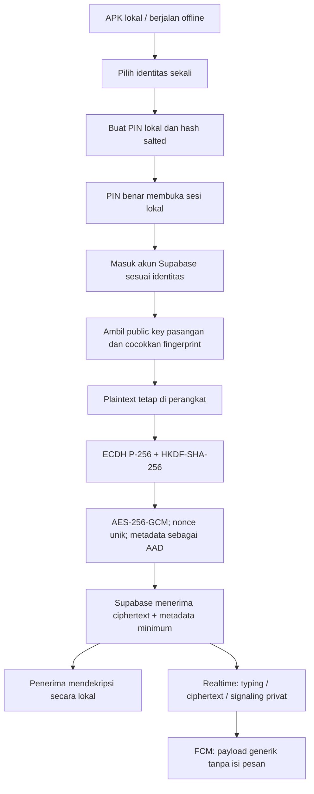

# Our Space — Arsitektur dan Batas Keamanan

**Status:** Fase 0 — rancangan saja; belum ada fitur diimplementasikan.  
**Tanggal verifikasi layanan:** 20 Oktober 2026.  
**Repositori:** [midznight/HN](https://github.com/midznight/HN). File acuan aktual: [prototipe UI.html](https://github.com/midznight/HN/blob/main/prototipe%20UI.html).

## 1. Audit prototipe

File aktual bernama `prototipe UI.html`, bukan `our_space_couple_app.html`. Versi yang diambil dari GitHub berisi 48.734 karakter dan 748 baris teks. Root repo saat audit berisi README dan file prototipe; belum ada kerangka Android/backend aplikasi pada repo ini.

| Temuan | Status dan dampak |
|---|---|
| PIN `1208` | **Terbukti** ada di placeholder sekitar baris 170 dan pembandingan literal sekitar baris 721. Hapus keduanya pada Fase 1. PIN dibuat pengguna, disimpan sebagai hash salted. Jangan gunakan `1208` karena sama dengan 12 Agustus dalam format DDMM. |
| Dependensi eksternal | **Terbukti:** Inter dari Google Fonts, Tailwind CDN, Lucide `@latest`, gambar Unsplash untuk latar, avatar, obrolan dan pratinjau brankas. Bundel semua aset lokal dan pin versi. Tidak boleh ada permintaan runtime ke domain pihak ketiga. |
| Font Playfair Display | Font serif diatur dalam CSS tetapi file font yang dimuat hanya Inter. Bundel Inter dan Playfair Display secara lokal. |
| Data statis | **Terbukti:** “Aug 12, 2021”, “1,024 Days”, “42 days”, pesan chat, status online/mengetik, log panggilan, “42 Jam”, “12GB / 50GB”, dan jumlah item folder. Semua contoh, bukan data nyata. Tanggal prototipe 12 Agustus 2021 perlu dikonfirmasi sebelum anniversary diaktifkan. |
| Identitas | **Terbukti:** UI selalu memakai “Hamid & Nur”; belum ada pilihan identitas. Tambah onboarding sekali “Aku Hamid” / “Aku Nur” yang menentukan akun server, sisi gelembung pesan, lawan bicara, dan pasangan kunci. |
| Interaksi media/panggilan | Ada composer teks, gambar contoh, dan animasi waveform, tetapi belum ada fungsi rekam, lampiran, unggah, simpan galeri, atau panggilan. Sebagian tombol hanya visual. |
| Dashboard | Aktivitas Nur, Rencana Masa Depan, dan Agenda Akhir Pekan berisi contoh yang tampak nyata. Pertahankan gaya/tata letak; tandai “Belum aktif” sampai Fase 8 diminta. |
| Android lifecycle | Ada padding safe-area bawah, tetapi belum ada Back native, lock saat background, atau pengelolaan keyboard yang nyata. Blur digunakan luas; siapkan fallback tanpa blur pada perangkat lambat. |
| Keluar akun | Tombol ada tetapi belum terhubung. Pisahkan logout biasa dari hapus private key; penghapusan key harus meminta konfirmasi bahwa riwayat terenkripsi tidak bisa dibuka tanpa key. |

## 2. Arsitektur yang diusulkan

Satu aplikasi Android untuk dua pengguna. Pertahankan HTML/CSS/JavaScript prototipe; gunakan Capacitor sebagai native wrapper. Jangan menambahkan framework frontend yang tidak diperlukan.

- **UI dan aset:** Tailwind dibangun dengan CLI lokal di GitHub Actions; Lucide, font, gambar dan latar dibundel. Sampai foto pilihan sendiri disediakan, gunakan monogram/ilustrasi lokal.
- **Identitas akun:** dua akun Supabase Auth tetap, satu untuk Hamid dan satu untuk Nur. Password tidak boleh ditanam di APK atau repo. Onboarding perlu mengaitkan identitas terpilih dengan kredensial akun satu kali; sesi/token selanjutnya memakai penyimpanan native. Memilih nama saja tidak boleh memberi hak masuk ke server.
- **PIN lokal:** bukan password Supabase dan bukan kunci E2EE. Gunakan salt acak per perangkat, PBKDF2-HMAC-SHA-256 dengan iterasi yang diuji di ponsel, jeda eksponensial untuk PIN salah, dan relock saat app masuk background. Rekomendasi PIN numerik minimal 6 digit; PIN 4 digit hanya memiliki 10.000 kombinasi.
- **Backend:** Supabase Postgres, Realtime, Storage, Edge Functions. Server menyimpan ciphertext, public key, push token, metadata minimum dan status panggilan seperlunya. Tidak ada plaintext, preview pesan atau private key di server.
- **Panggilan:** WebRTC, Supabase Realtime untuk signaling privat. Coba koneksi media langsung lebih dulu; TURN hanya relay fallback. SDP/ICE tidak disimpan sebagai riwayat permanen.
- **Push:** Firebase Cloud Messaging (FCM). Payload hanya memuat metadata minimum seperti jenis peristiwa dan ID buram; tanpa teks, caption, nama file, gambar atau kunci. Konten didekripsi di perangkat.
- **Rahasia server:** service account Firebase dan API key TURN hanya berada di environment fungsi server. Jangan masukkan ke JavaScript, APK atau repo.

## 3. Persetujuan diperlukan untuk penyimpanan kunci E2EE

Ada benturan teknis: private key Web Crypto yang dibuat dengan `extractable: false` tidak dapat diekspor/dibungkus untuk dimasukkan ke Android Keystore; menyimpan `CryptoKey` di IndexedDB tidak otomatis menjadikannya kunci Android Keystore. Referensi: [MDN — CryptoKey.extractable](https://developer.mozilla.org/en-US/docs/Web/API/CryptoKey/extractable) dan [Android Keystore](https://developer.android.com/privacy-and-security/keystore).

**Rekomendasi:** buat pasangan kunci ECDH P-256 langsung di Android Keystore melalui plugin Capacitor native kecil yang memakai API Android resmi. Private key tidak diekspor; plugin melakukan operasi ECDH, lalu Web Crypto menangani HKDF-SHA-256 dan AES-256-GCM. Public key ditukar lewat Supabase dan fingerprint diverifikasi langsung oleh Hamid dan Nur. **Ini menyimpang dari persyaratan ECDH yang sepenuhnya dilakukan oleh Web Crypto; jangan terapkan tanpa persetujuan.**

Alternatifnya, Web Crypto perlu mengekspor kunci privat sementara agar dapat dibungkus dengan kunci Keystore, atau menyimpan CryptoKey di penyimpanan web yang bukan Keystore. Keduanya memiliki batas perlindungan berbeda dan bukan rekomendasi utama.

Alur pesan setelah keputusan disetujui:
1. Setiap perangkat membuat private key lokal dan mengunggah public key saja.
2. Kedua pengguna membandingkan fingerprint public key lewat kode pendek/QR. Perubahan key menampilkan peringatan dan perlu diverifikasi ulang.
3. Turunkan kunci pesan dari rahasia ECDH dengan HKDF dan konteks yang mengikat pasangan, arah pengirim/penerima, serta versi kunci.
4. Enkripsi pesan dengan AES-256-GCM. Gunakan nonce acak unik 96-bit per enkripsi; simpan nonce bersama ciphertext. Ikat pair ID, message ID, sender ID, jenis pesan dan versi key sebagai AAD.
5. Server menerima ciphertext, nonce, key version, ID, timestamp dan metadata routing minimum saja. Private key tidak pernah dikirim.
6. Kehilangan private key berarti riwayat lama tidak bisa didekripsi dari server. Logout biasa tidak menghapus key; hapus key harus berupa aksi terpisah dengan peringatan.

**Batas keamanan:** ECDH statis tanpa ratchet belum memberi forward secrecy untuk seluruh riwayat. Jika private key dicuri, ciphertext lama yang tersedia mungkin bisa didekripsi. Catat sebagai risiko sampai audit Fase 7; jangan menyebut aplikasi “seaman WhatsApp” tanpa bukti implementasi dan audit.

## 4. Skema data konseptual

Rancangan ini untuk migrasi Fase 2/6, bukan tabel yang sudah dibuat pada Fase 0.

| Tabel | Kolom inti | Aturan |
|---|---|---|
| `pair_members` | `pair_id`, `user_id`, `display_name` | Tepat dua anggota: UUID akun Hamid dan Nur. Seed admin/migrasi; klien tidak dapat menambah/mengganti anggota. |
| `device_keys` | `id`, `pair_id`, `user_id`, `public_key_jwk`, `fingerprint_sha256`, `key_version`, timestamps | Public key saja, tanpa private key. Rotasi key perlu verifikasi ulang. |
| `key_verifications` | `pair_id`, `verifier_user_id`, `verified_fingerprint`, `key_version`, `verified_at` | Catatan hasil verifikasi fingerprint. |
| `messages` | `id`, `pair_id`, `sender_id`, `ciphertext`, `nonce`, `key_version`, `message_type`, `created_at` | Append-only pada versi awal. Tidak ada kolom plaintext. |
| `media_objects` | `id`, `pair_id`, `sender_id`, `object_path`, `ciphertext_bytes`, `created_at` | Path buram/UUID dan object terenkripsi; nama file, caption, MIME asli, thumbnail dan media key berada di payload terenkripsi. |
| `call_logs` | `id`, `pair_id`, `initiator_id`, `call_type`, `started_at`, `ended_at`, `end_reason` | Hanya panggilan nyata; durasi dihitung dari timestamp. |
| `push_tokens` | `user_id`, `device_id`, `fcm_token`, `updated_at`, `enabled` | Pengguna mengelola token perangkat sendiri; fungsi server memakai token penerima untuk push generik. |

Typing indicator memakai Realtime broadcast privat dan tidak disimpan permanen. Jangan tulis plaintext ke log app, analytics, error report atau log server.

### RLS dan bucket

Aktifkan RLS di semua tabel yang dapat diakses client dan cabut grant anon yang tidak dibutuhkan. RLS dan SQL GRANT harus sama-sama benar. Acuan: [dokumentasi resmi RLS Supabase](https://supabase.com/docs/guides/database/postgres/row-level-security).

| Objek | SELECT | INSERT | UPDATE / DELETE |
|---|---|---|---|
| `pair_members` | Hanya baris `user_id = auth.uid()` | Ditolak untuk client | Ditolak untuk client |
| `device_keys` | Anggota pasangan | Hanya akun sendiri yang terdaftar | Hanya pemilik untuk rotasi/revoke valid |
| `key_verifications` | Anggota pasangan | Hanya verifier login dan anggota pasangan | Perubahan key memerlukan verifikasi baru |
| `messages` | Hanya anggota `pair_id` terdaftar | Anggota pasangan dan `sender_id = auth.uid()` | Ditolak pada versi awal |
| `media_objects` | Hanya anggota pasangan | Anggota pasangan dan `sender_id = auth.uid()` | Penghapusan sesuai policy pemilik |
| `call_logs` | Hanya anggota pasangan | Anggota sebagai inisiator | Hanya transisi panggilan yang diizinkan |
| `push_tokens` | Pemilik saja | `user_id = auth.uid()` | Pemilik saja |
| Bucket privat `our-space-encrypted-media` | Hanya anggota pasangan | Anggota pasangan; path buram | Sesuai policy pemilik/anggota; bucket tidak public |

Uji langsung di database dengan akun ketiga untuk SELECT, INSERT, UPDATE, DELETE, Realtime dan unduh object. RLS tidak melindungi data dari kebocoran service-role key karena service role melewati RLS; simpan hanya di environment server/CI terbatas.

## 5. Kuota gratis dan keterbatasan — dicek 20 Oktober 2026

Nilai berasal dari halaman resmi saat pemeriksaan; cek ulang sebelum provisioning/rilis karena dapat berubah.

- **Supabase Free:** database 500 MB/project, Storage 1 GB, egress 5 GB cached + 5 GB uncached, upload global Free hingga 50 MB per file. Ini bukan 50 GB; UI harus membaca penggunaan aktual dan menangani kuota habis. Sumber: [billing/quota](https://supabase.com/docs/guides/platform/billing-on-supabase), [Storage pricing](https://supabase.com/docs/guides/storage/pricing), [upload limits](https://supabase.com/docs/guides/storage/uploads/file-limits), [egress](https://supabase.com/docs/guides/platform/manage-your-usage/egress).
- **Ketersediaan Supabase:** project Free dapat dipause setelah aktivitas rendah sekitar 7 hari. Aplikasi tak bisa memakai backend hingga project dilanjutkan di dashboard. Sumber: [Free project pausing](https://supabase.com/docs/guides/platform/free-project-pausing).
- **FCM:** Firebase mencantumkan Cloud Messaging sebagai produk gratis; Spark tidak meminta informasi pembayaran untuk penggunaan produk gratis. Sumber: [Firebase pricing plans](https://firebase.google.com/docs/projects/billing/firebase-pricing-plans). Delivery tetap tergantung izin, jaringan, Google Play Services dan kebijakan perangkat.
- **TURN:** halaman Metered Open Relay saat diperiksa menyatakan 20 GB relay gratis/bulan; Metered Realtime menyebut tier gratis tanpa kartu dengan 100 koneksi serentak dan 100.000 pesan/bulan. Sumber: [Open Relay](https://www.metered.ca/tools/openrelay/) dan [Realtime free tier](https://www.metered.ca/tools/openrelay/webrtc-signaling-server/). Kuota terbatas, bukan jaminan koneksi universal; API key harus di server, cek ulang pada Fase 5.
- **Panggilan saat app tertutup:** FCM dan notifikasi panggilan prioritas tinggi adalah opsi terbaik dalam batas Android, tetapi tidak menjamin dering setara WhatsApp. Android 14+ membatasi full-screen intent untuk aplikasi panggilan/alarm dan pengguna bisa mematikannya. Force-stop, optimasi baterai OEM, jaringan atau kuota relay dapat menghalangi panggilan. Sumber: [perubahan Android 14](https://developer.android.com/about/versions/14/behavior-changes-14).

Semua versi dependency dipin pada manifest dan lockfile saat implementasi. Jangan gunakan CDN, script eksternal, atau `@latest` saat runtime.

## 6. Rencana fase

- **Fase 1:** kerangka Capacitor, aset lokal, PIN/identitas lokal, Back/safe area/background lock, APK debug via Actions.
- **Fase 2:** dua akun Auth, migrasi/RLS, pertukaran kunci, fingerprint dan chat teks E2EE.
- **Fase 3:** media terenkripsi, rekam notes, progress/error, penampil dan penyimpanan galeri Android.
- **Fase 4:** FCM, payload generik, uji izin Android 13+.
- **Fase 5:** WebRTC, signaling, TURN berkuota dan uji background dengan caveat.
- **Fase 6:** brankas terenkripsi dan log panggilan nyata.
- **Fase 7:** audit keamanan, uji akun ketiga/RLS, dokumentasi akhir.
- **Fase 8:** tidak dikerjakan kecuali diminta.

Fase 0 tidak mengubah UI/kode fitur, tidak menjalankan migrasi, tidak membuat akun cloud, dan tidak menyatakan fitur telah lulus uji.
